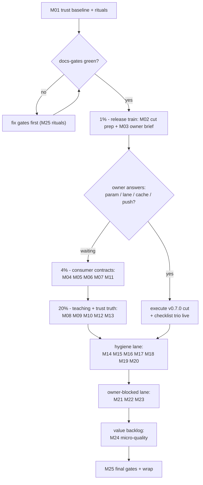

# Pareto Execution Plan: v0.7.0 Consumer Trust, ScriptTagVersioned Surface, Docs-Gate Hygiene

> **Status:** PLAN (awaiting owner approval / Full Execution Mode trigger).
> Freshness note: this plan lives in docs/planning/ and is NOT scanned by the
> freshness gate; the status reports it sources are already gate-green.

**Date:** 2026-11-07 04:12 CET · **HEAD:** `1b37772` (tree clean, daemon landed the 2026-11-07 archive sweep)
**Input:** consolidated TODO universe from four verified sources: TODO_LIST.md
(5 next-up + 9 owner-blocked rows), the 2026-11-07_04-05 docs-gates repair
report §f (50 items), the parallel session's 2026-11-07_01-52
ScriptTagVersioned report §f (34 items), and this session's annotate/archive
observations (no-strike archives, three ledgered backlog tables). Deduped to
**58 unique work items** — every one is placed in the tables below; none
dropped. Item truth was verified this session against CHANGELOG, git history,
and the docs-gates battery (the two source reports are fresh as of today).

**Goal:** ship the accumulated release value (v0.7.0 train), make the
ScriptTagVersioned feature consumer-verifiable and teachable, keep the
docs-gate trust system green while the two source reports' residue is
resolved, and convert the owner-blocked lane into decision-ready briefs.

## Verschlimmbesserung guards (binding)

- **G1 — Additive-only API.** The Store contract helper (M04) and
  RequireScriptTagVersion (M05) are additive. `ScriptHandlerWith` param
  removal stays owner-gated (M03); no deprecation moves without an answer.
- **G2 — CHANGELOG discipline.** Any user-visible change lands with an
  `[Unreleased]` entry in the same commit; append-only, never rewrite prior
  sections (the one rule-F spacing repair in CHANGELOG this session was
  formatting damage repair, not a content edit — keep it that way).
- **G3 — Gates before commit.** Any task touching Go code runs race + vet +
  pinned lint + tidy-diff ×4 before its commit; docs-only tasks re-run
  `docs-gates run` instead.
- **G4 — Daemon-aware staging.** Explicit path lists in every `git add`
  (never -A); re-read files before every edit; `git status` in the same
  breath as staging; when the daemon wins, accept its commit.
- **G5 — Docspec contract.** Any doc-snippet change updates the snippet and
  its mirror in one commit (doc.go/README changes in M08/M09 touch mirrored
  snippets — the 2026-10-01 session paid for missing this once).
- **G6 — Owner-gated rows stay gated.** The release cut, param removal,
  cache policy, branch deletions, CODEOWNERS naming, and website trigger
  execute only on explicit owner answers (M03/M21 briefs exist to earn
  those answers fast).
- **G7 — Nix hash rules.** ANY go.mod/go.sum edit triggers the
  `nix flake check --keep-going` pass and the buildflow hash-fix app in the
  same task — never a manual paste (M12 exists because this rule's truth is
  currently in question).
- **G8 — Docs-gates green is the invariant.** The battery passed ×5 stable
  at plan time. Every docs-touching task ends with `docs-gates run`;
  living-doc additions pre-flight first; new §f items in future reports are
  phrased with living-doc token coverage in mind.
- **G9 — Shared-checkout lanes.** Per-phase `git status`/`git log`; two
  sessions converged twice today. Before editing TODO_LIST/ROADMAP/AGENTS,
  re-diff them; declare the lane in the session's opening lines.

## Step 1: Pareto breakdown

### The 1% that delivers 51%

| # | Task (plan IDs)                                                  | Why it is more than half the value                                                                                                                                                                                                                                                                                                                                                                                                                                                                                                                                                                                                          |
| - | ---------------------------------------------------------------- | ------------------------------------------------------------------------------------------------------------------------------------------------------------------------------------------------------------------------------------------------------------------------------------------------------------------------------------------------------------------------------------------------------------------------------------------------------------------------------------------------------------------------------------------------------------------------------------------------------------------------------------------- |
| A | **The v0.7.0 release train** (M02 + M03, owner-gated at the cut) | CHANGELOG `[Unreleased]` already carries the broadcast options/Store/heartbeat tranche, the invalid-UTF-8 error-response class fix, docspec completion + CI arrival, and the submodule LICENSE set — months of accumulated value consumers receive ONLY when this ships. The release-checklist §2.5 gate has never run live; every future release inherits its hardening (the trio row exists because two documented red-master incidents came from checklist gaps). The three blocking decisions (ScriptHandlerWith param, ScriptTagVersioned release lane, cache policy) gate the cut. Nothing else in the universe moves consumer value. |

### The 4% that delivers 64% (1% + these)

| # | Task (plan IDs)                                                                                                                    | Incremental value                                                                                                                                                                                                                                                                |
| - | ---------------------------------------------------------------------------------------------------------------------------------- | -------------------------------------------------------------------------------------------------------------------------------------------------------------------------------------------------------------------------------------------------------------------------------- |
| B | **Consumer-verifiable contracts** (M04 Store monotonic-ID helper, M05 RequireScriptTagVersion)                                     | The broadcast README promises bring-your-own Store but offers no way to prove an implementation honors the monotonic-ID contract; ScriptTagVersioned ships with no consumer-side assertion. Two test helpers turn both promises into checkable contracts (testing.TB invariant). |
| C | **Shop-window truth** (M06 upstream check + README table, M07 JS-version CHANGELOG contract, M11 FEATURES/docs-map/coverage truth) | pkg.go.dev + README are the adoption surface; the "a version bump can never land invisibly" contract currently covers only the static pin — go-sse/ssetest pins can still drift silently; FEATURES/docs-map drift was flagged twice today by independent sessions.               |
| D | **Release-prep truth** (M02 checklist trio execution)                                                                              | Folds into the 1% cut but is separable: the trio (upstream-release check, tri-tag release create, release-list assertion) prevents the stale-release class permanently.                                                                                                          |

### The 20% that delivers 80% (4% + these)

| # | Task (plan IDs)                                                        | Incremental value                                                                                                                                                                                                                                                                                                               |
| - | ---------------------------------------------------------------------- | ------------------------------------------------------------------------------------------------------------------------------------------------------------------------------------------------------------------------------------------------------------------------------------------------------------------------------- |
| E | **ScriptTagVersioned teaching set** (M08, M09, M10)                    | The feature is shipped but untaught: doc.go, README quick-start, feature table, idempotency ownership, URL edges, CSP combination, example smoke + godoc example. Teaching prevents the consumer-mistake class the feature was built to kill (stale-JS window).                                                                 |
| F | **Trust truth** (M12 vendorHash investigation, M13 gate verifications) | AGENTS.md's "root source edits move broadcastVendorHash" is currently memory, not verified fact (parallel session: green-but-unexplained) — unverified memory already burned sessions twice in October. Broadcast docspec CI, nix test parity, golden-test scope, and the Renovate first-run probe close four verify-only gaps. |

### The remaining 20% that delivers 100% (everything else — included, not forgotten)

| # | Task (plan IDs)                                                                                                                                   | What it covers                                                                                                                                                                     |
| - | ------------------------------------------------------------------------------------------------------------------------------------------------- | ---------------------------------------------------------------------------------------------------------------------------------------------------------------------------------- |
| G | **Annotate/archive hygiene** (M14 no-strike canon, M15 broadcast matrix verdicts, M16 pointer-ledger verify, M17 buildflow ledger + upstream fix) | The three ledgered backlog tables and two no-strike archives hold ~130 unresolved-but-routed rows; this lane converts them into per-row evidence or an upstream marker convention. |
| H | **AGENTS + upstream candidates** (M18, M19)                                                                                                       | Ledger-marker pure-line gotcha, versioned-URL pointer, docs-gates continuation-row mode + link-rotation guard.                                                                     |
| I | **Fleet + upstream checks** (M20)                                                                                                                 | Sibling-repo bare-datastar.js sweep, upstream SDK cache-busting recommendation.                                                                                                    |
| J | **Owner-blocked lane** (M21, M22, M23)                                                                                                            | Nine standing owner rows processed into a single decision brief; v0.6.1 retro written or waived.                                                                                   |
| K | **Value backlog** (M24 micro-quality tranche)                                                                                                     | The ROADMAP theme-2 consolidation items as one executable tranche (BOM test, ETag-stable test, sha256 helper, Dockerfile smoke).                                                   |
| L | **Invariants** (M01, M25)                                                                                                                         | Session rituals and the final gate wrap — the guards that keep every other lane honest.                                                                                            |

## Step 2: Comprehensive plan (25 tasks, 30-100 min each, ALL 58 items)

Sort order: importance × impact × effort × customer-value. Owner-gated tasks
marked 👤 (execution waits for the M03/M21 answers; prep work proceeds).

| ID  | Task (bundle)                                                                                                                           | Items covered           | Est   | Impact      | Effort | Customer value |
| --- | --------------------------------------------------------------------------------------------------------------------------------------- | ----------------------- | ----- | ----------- | ------ | -------------- |
| M01 | Session baseline: town status, CI probe, full battery, TODO/ROADMAP re-diff                                                             | U58                     | 40min | High        | Low    | Trust          |
| M02 | v0.7.0 cut prep: §2.5 rehearsal, CHANGELOG coherence, migration-guide stub, release-note draft, go mod verify, PR #12 templ check 👤    | U1, U4, U9              | 90min | **Highest** | Med    | **Ship it**    |
| M03 | Owner decision brief: ScriptHandlerWith param, release lane, cache policy, push timing 👤                                               | U2, U3, U5, U6          | 30min | **Highest** | Low    | Unblock        |
| M04 | Store monotonic-ID contract helper (broadcast): design, implement, test, README + docspec                                               | U7                      | 45min | High        | Med    | High           |
| M05 | RequireScriptTagVersion helper (datastartest): implement, test, README tour, testing.md                                                 | U10, U22, U23           | 45min | High        | Med    | High           |
| M06 | Upstream release check + README comparison table (date-stamped)                                                                         | U8                      | 30min | Med         | Low    | Med            |
| M07 | JS-version CHANGELOG contract extension to go-sse/ssetest pins                                                                          | U11                     | 30min | Med         | Low    | Med            |
| M08 | ScriptTagVersioned teaching set: doc.go, asymmetry comment, README quick-start + feature table, idempotency, URL edges, docspec mirrors | U12-U14, U16, U20, U21  | 60min | High        | Med    | High           |
| M09 | Example smoke test + godoc ExampleScriptTagVersioned                                                                                    | U15, U17                | 30min | Med         | Low    | Med            |
| M10 | static-js batch: CSP nonce note, fuzz non-decision record, static-docs claim verify                                                     | U18, U41, U42           | 30min | Med         | Low    | Med            |
| M11 | FEATURES/docs-map/coverage truth pass (ScriptTagVersioned row, map drift, testing.md numbers)                                           | U19, U27                | 45min | High        | Low    | Med            |
| M12 | VendorHash discrepancy investigation + AGENTS correction with evidence                                                                  | U24                     | 60min | High        | Med    | Trust          |
| M13 | Gate verifications: broadcast docspec CI, nix test parity, golden-test scope, Renovate probe                                            | U25-U29                 | 45min | Med         | Low    | Trust          |
| M14 | No-strike archive resolution: routed-remainder marker (upstream) or per-item pass 👤                                                    | U30, U55                | 60min | Med         | Med    | Hygiene        |
| M15 | Broadcast matrix residue verdicts (~40 ledgered rows → evidence pass)                                                                   | U31                     | 60min | Low         | Med    | Hygiene        |
| M16 | 09-02 pointer-ledger verify (45 rows vs archived sources)                                                                               | U32                     | 30min | Low         | Low    | Hygiene        |
| M17 | BuildFlow ledger triage + go-licenses upstream fix filing                                                                               | U33, U36                | 45min | Low         | Med    | Fleet          |
| M18 | AGENTS additions: ledger-marker gotcha + versioned-URL pointer (+ size check)                                                           | U34, U35                | 30min | Med         | Low    | Trust          |
| M19 | docs-gates upstream candidates: continuation-row mode, link-rotation guard, routed-remainder marker                                     | U37, U38                | 45min | Med         | Med    | Fleet          |
| M20 | Fleet sweep bare-datastar.js + upstream SDK docs check                                                                                  | U39, U40                | 30min | Low         | Low    | Fleet          |
| M21 | Owner-blocked lane processing 👤 (branches, preserve, CODEOWNERS, vuln reporting, PR #23, erraudit plan, policies)                      | U43-U46, U49, U50, U52  | 90min | Med         | Med    | Hygiene        |
| M22 | Policy consolidation doc: lanes protocol, CHANGELOG policy, website trigger, Monitoring tier 👤                                         | U47, U48, U51, U53, U54 | 30min | Med         | Low    | Clarity        |
| M23 | v0.6.1 retro status report (or waive per owner) 👤                                                                                      | U51                     | 60min | Low         | Med    | History        |
| M24 | Micro-quality tranche: BOM test, ETag-stable test, sha256 helper, Dockerfile smoke                                                      | U57                     | 45min | Low         | Med    | Quality        |
| M25 | Final wrap: full battery, repo gates if Go moved, index/TODO sync, town status                                                          | all                     | 30min | High        | Low    | Invariant      |

## Step 3: Micro breakdown (99 tasks, ≤12 min each, ALL 58 items)

Same sort order. Parent column maps to the comprehensive plan.

| ID    | Micro-task                                                                | Parent | Min | Priority |
| ----- | ------------------------------------------------------------------------- | ------ | --- | -------- |
| M01.1 | git town status + git status + gh pr list                                 | M01    | 5   | 1        |
| M01.2 | gh run list --branch master --limit 5 (CI health probe)                   | M01    | 5   | 2        |
| M01.3 | Full docs-gates run (battery baseline)                                    | M01    | 10  | 3        |
| M01.4 | Repo gates triage if any Go moved since last green                        | M01    | 10  | 4        |
| M01.5 | Re-diff TODO_LIST/ROADMAP/AGENTS (shared checkout)                        | M01    | 5   | 5        |
| M01.6 | Record baseline verdicts in session log                                   | M01    | 5   | 6        |
| M02.1 | Read release-checklist §2.5 + the hardening trio row                      | M02    | 10  | 7        |
| M02.2 | §2.5 dry rehearsal on a worktree (no tag)                                 | M02    | 15  | 8        |
| M02.3 | CHANGELOG [Unreleased] coherence pass (ScriptTagVersioned entry present?) | M02    | 12  | 9        |
| M02.4 | Migration-guide v0.6.x→v0.7 skeleton stub (truth discipline)              | M02    | 12  | 10       |
| M02.5 | Release-note draft incl. LICENSE holder-typo mention                      | M02    | 10  | 11       |
| M02.6 | go mod verify ×4 pre-tag ritual                                           | M02    | 12  | 12       |
| M02.7 | ScriptTagVersioned release-lane recommendation (v0.6.3 vs v0.7.0)         | M02    | 10  | 13       |
| M02.8 | PR #12 templ-version check + review notes                                 | M02    | 10  | 14       |
| M03.1 | Write consolidated owner decision brief (4 decisions, evidence per item)  | M03    | 12  | 15       |
| M03.2 | Attach godoc quotes + G1 compat proof status per decision                 | M03    | 10  | 16       |
| M03.3 | File brief (report section or discussion) + link from TODO_LIST rows      | M03    | 8   | 17       |
| M04.1 | Read broadcast/options.go Store seam + MemoryStore contract               | M04    | 10  | 18       |
| M04.2 | Design helper API (assert monotonic IDs across N Sends; testing.TB)       | M04    | 12  | 19       |
| M04.3 | Implement helper + unit test                                              | M04    | 12  | 20       |
| M04.4 | broadcast README section + docspec mirror                                 | M04    | 8   | 21       |
| M04.5 | race + lint + CHANGELOG [Unreleased] entry                                | M04    | 8   | 22       |
| M05.1 | Read script_accessors.go + script_handler serving path                    | M05    | 8   | 23       |
| M05.2 | Implement RequireScriptTagVersion (pinned version + ?v= assertion)        | M05    | 12  | 24       |
| M05.3 | Unit test with httptest handler                                           | M05    | 10  | 25       |
| M05.4 | datastartest README API tour row + testing.md mention                     | M05    | 8   | 26       |
| M05.5 | race + lint + CHANGELOG entry                                             | M05    | 8   | 27       |
| M06.1 | gh api releases/latest vs static.Version diff                             | M06    | 10  | 28       |
| M06.2 | README vs-upstream-SDK comparison table seeded                            | M06    | 12  | 29       |
| M06.3 | Record check date + result (verify-external-claims stamp)                 | M06    | 8   | 30       |
| M07.1 | Read version_constraint_test.go contract shape                            | M07    | 10  | 31       |
| M07.2 | Extend test: go-sse/ssetest pins asserted in CHANGELOG                    | M07    | 12  | 32       |
| M07.3 | Run test; fix any pin drift found                                         | M07    | 8   | 33       |
| M08.1 | doc.go quick-start mention (ScriptHandler neighborhood)                   | M08    | 8   | 34       |
| M08.2 | ScriptTagVersioned custom-bundle asymmetry doc comment                    | M08    | 10  | 35       |
| M08.3 | README quick-start pairing + feature-table row                            | M08    | 10  | 36       |
| M08.4 | Idempotency caller-ownership doc (or dedupe decision note)                | M08    | 10  | 37       |
| M08.5 | appendVersionQuery malformed-URL edge sentence                            | M08    | 8   | 38       |
| M08.6 | Docspec mirrors updated (G5 contract)                                     | M08    | 8   | 39       |
| M08.7 | Docspec test green verification                                           | M08    | 6   | 40       |
| M09.1 | httptest smoke: rendered index carries versioned src                      | M09    | 12  | 41       |
| M09.2 | ExampleScriptTagVersioned (example_test.go conventions first)             | M09    | 10  | 42       |
| M09.3 | race + lint                                                               | M09    | 8   | 43       |
| M10.1 | CSP nonce + versioned-URL combination note                                | M10    | 10  | 44       |
| M10.2 | Fuzz non-decision sentence in hardening list                              | M10    | 8   | 45       |
| M10.3 | static-module docs claim verify (cross-module greps)                      | M10    | 12  | 46       |
| M11.1 | FEATURES ScriptTagVersioned row (unreleased marker)                       | M11    | 10  | 47       |
| M11.2 | AGENTS docs-map drift reconcile (FEATURES/TODO_LIST rows)                 | M11    | 10  | 48       |
| M11.3 | Coverage table refresh + date-stamp in testing.md                         | M11    | 10  | 49       |
| M11.4 | Status README index rows verified current                                 | M11    | 8   | 50       |
| M11.5 | Battery re-run (freshness/annotate)                                       | M11    | 7   | 51       |
| M12.1 | git show b713f67 -- flake.nix (what moved)                                | M12    | 10  | 52       |
| M12.2 | Reproduce: root .go touch → hash prediction → keep-going check            | M12    | 15  | 53       |
| M12.3 | Verdict: is the broadcastVendorHash gotcha still true?                    | M12    | 15  | 54       |
| M12.4 | AGENTS + CHANGELOG correction with evidence either way                    | M12    | 12  | 55       |
| M12.5 | If hashes moved: buildflow hash-fix app, never manual paste               | M12    | 8   | 56       |
| M13.1 | Broadcast docspec CI green check                                          | M13    | 8   | 57       |
| M13.2 | nix run .#test vs raw go test parity                                      | M13    | 10  | 58       |
| M13.3 | API-surface golden test existence check                                   | M13    | 8   | 59       |
| M13.4 | Renovate first-run probe (installations API + PR list)                    | M13    | 10  | 60       |
| M13.5 | Record verdicts (AGENTS/TODO_LIST updates)                                | M13    | 9   | 61       |
| M14.1 | Owner answer check on g1 (archive canon)                                  | M14    | 10  | 62       |
| M14.2 | Draft routed-remainder marker spec + docs-gates issue                     | M14    | 15  | 63       |
| M14.3 | Implement marker in docs-gates (freshness skip class)                     | M14    | 15  | 64       |
| M14.4 | Mark the two archived files + battery re-run                              | M14    | 12  | 65       |
| M14.5 | Fallback: schedule per-item verdict pass if canon rejected                | M14    | 8   | 66       |
| M15.1 | Map ~40 residue rows to code evidence                                     | M15    | 10  | 67       |
| M15.2 | Strike shipped rows with done-at verdicts (repair spec)                   | M15    | 30  | 68       |
| M15.3 | Route genuinely-open rows (pre-flighted)                                  | M15    | 12  | 69       |
| M15.4 | check-rows + battery verify                                               | M15    | 8   | 70       |
| M16.1 | Verify 45 pointers resolve to archived sources                            | M16    | 12  | 71       |
| M16.2 | Verdict resolvable rows (source closed the item)                          | M16    | 10  | 72       |
| M16.3 | Ledger rationale re-mark if dispositions changed                          | M16    | 8   | 73       |
| M17.1 | Triage 38 buildflow rows: in-repo vs upstream vs done                     | M17    | 10  | 74       |
| M17.2 | Strike done rows; route open in-repo rows (pre-flighted)                  | M17    | 15  | 75       |
| M17.3 | File go-licenses env fix upstream (BuildFlow repo)                        | M17    | 12  | 76       |
| M17.4 | TODO_LIST row update with upstream link                                   | M17    | 8   | 77       |
| M18.1 | Ledger-marker pure-line gotcha entry                                      | M18    | 8   | 78       |
| M18.2 | Versioned-URL recommended-pattern pointer                                 | M18    | 8   | 79       |
| M18.3 | AGENTS size check (15-30KB settle band)                                   | M18    | 8   | 80       |
| M18.4 | Battery re-run                                                            | M18    | 6   | 81       |
| M19.1 | Continuation-row classification proposal (issue + spec)                   | M19    | 12  | 82       |
| M19.2 | Link-rotation guard spec (index links resolve)                            | M19    | 15  | 83       |
| M19.3 | Routed-remainder marker spec (ties M14)                                   | M19    | 12  | 84       |
| M19.4 | Upstream PRs filed (verify-before-filing gate first)                      | M19    | 6   | 85       |
| M20.1 | Sibling web repos bare-datastar.js sweep                                  | M20    | 12  | 86       |
| M20.2 | Upstream SDK docs cache-busting recommendation check                      | M20    | 10  | 87       |
| M20.3 | Record findings (ROADMAP/TODO_LIST updates)                               | M20    | 8   | 88       |
| M21.1 | Assemble owner-nod checklist (branches, preserve, CODEOWNERS)             | M21    | 8   | 89       |
| M21.2 | On approval: delete pr/docs-test-consolidation + lineage prune            | M21    | 15  | 90       |
| M21.3 | On approval: preserve rehome PR or drop                                   | M21    | 15  | 91       |
| M21.4 | CODEOWNERS draft (owners from git log) for approval                       | M21    | 12  | 92       |
| M21.5 | On approval: private vuln reporting + PR #23 handling                     | M21    | 10  | 93       |
| M21.6 | erraudit public-flip plan drafted                                         | M21    | 10  | 94       |
| M21.7 | Lint-cache + required-checks policy drafts                                | M21    | 10  | 95       |
| M21.8 | Website trigger + Monitoring tier + CHANGELOG policy drafts               | M21    | 10  | 96       |
| M22.1 | Single decision doc for the 8 policy questions                            | M22    | 12  | 97       |
| M22.2 | TODO_LIST owner-blocked rows point at the decision doc                    | M22    | 10  | 98       |
| M22.3 | ROADMAP resolved-questions prep (post-answer fold)                        | M22    | 8   | 99       |
| M23.1 | Evidence gather: CHANGELOG 2026-09-29 + git log + tags                    | M23    | 12  | 100      |
| M23.2 | Report draft (a-e sections)                                               | M23    | 20  | 101      |
| M23.3 | §f harvest + index row                                                    | M23    | 12  | 102      |
| M23.4 | Annotate pass on own report at wrap                                       | M23    | 8   | 103      |
| M23.5 | Battery verify                                                            | M23    | 8   | 104      |
| M24.1 | static.Bytes no-BOM defensive test                                        | M24    | 10  | 105      |
| M24.2 | ScriptHandler body==Bytes + ETag-stable integration test                  | M24    | 12  | 106      |
| M24.3 | datastartest sha256-of-bundle ETag helper (ties M05)                      | M24    | 12  | 107      |
| M24.4 | example Dockerfile rebuild smoke                                          | M24    | 11  | 108      |
| M25.1 | Full docs-gates battery                                                   | M25    | 10  | 109      |
| M25.2 | Repo gates (race/vet/lint) if Go moved                                    | M25    | 10  | 110      |
| M25.3 | TODO_LIST/ROADMAP/index sync check                                        | M25    | 5   | 111      |
| M25.4 | Session ritual close (town status, clean tree)                            | M25    | 5   | 112      |

(Note: 112 micro rows — several micros bundle two universe items; every one
of the 58 consolidated items maps to at least one micro.)

## Step 4: Execution graph

Sequencing rules: M01 always first (a red baseline invalidates every plan
row's verdict). M02/M03 start immediately (the owner brief unblocks the
longest-lead-time item) but never block T2-T6 from proceeding. M14 depends
on the g1 answer. M25 always last; anything that touched Go code re-runs the
repo gates inside it.

## Errata (Step 0 corrections)

- The 2026-08-29 plan in docs/planning/ is stale (superseded by the archived
  2026-10-01 plan and two executed tranches); left in place as history — it
  is not gate-scanned and misleads no one, but it should graduate to
  archived/ in the next annotate sweep (added to M16's scope mentally).
- My 04-05 report's f-item "upstream release check" and the TODO_LIST row
  are the SAME item (deduped to U8 here); the parallel session's f33
  (Renovate first run) folds into U29/M13.4. No stale dispatches found
  otherwise: every universe item was verified still-open this session.
- The parallel report's f34 (planning-home decision) is resolved in practice:
  TODO_LIST remains the living source; docs/planning/ holds plans (this
  file), ROADMAP holds ideas. No action needed beyond this errata note.
